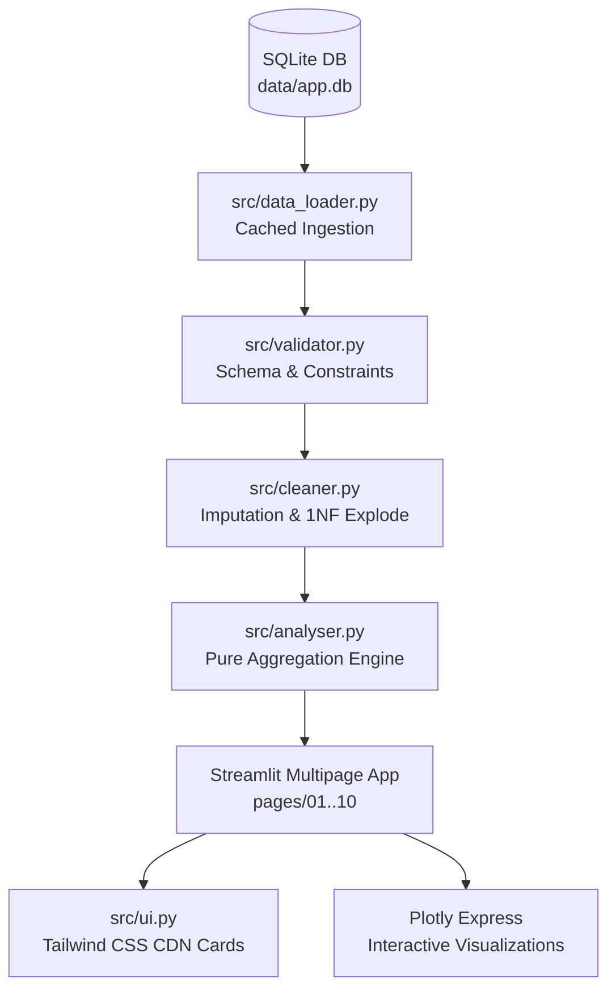

# 📊 P01 — Hiring Trend Analysis

[](https://2500320140004-hiringtrendanalysis.streamlit.app/)
[](https://www.python.org/downloads/release/python-3120/)
[](tests/)
[](LICENSE)

An end-to-end Data Analytics platform built to analyze hiring trends, benchmark compensation, identify in-demand skills, and evaluate geographic talent concentration across India's premier tech corridors.

---

## 👥 Project & Academic Metadata
- **Project ID & Title:** P01 – Hiring Trend Analysis
- **Domain:** Data Analytics
- **Student Name:** Abhayjeet Singh
- **Roll Number:** 2500320140004
- **Academic Programme:** MCA 2nd Year (Data Analytics), ABES Engineering College
- **Faculty Mentor:** Dinesh Sereno
- **Live Demo Deployment:** [Streamlit Community Cloud Link](https://2500320140004-hiringtrendanalysis.streamlit.app/)

---

## 🏛️ System Architecture



---

## 🚀 Key Features & Multipage Directory

| Page | Route | Operational Question Addressed | Key Visualization |
|---|---|---|---|
| **01 Overview** | `pages/01_📊_Overview.py` | Macro talent market summary | Tailwind KPI metric cards + Monthly timeline |
| **02 Role Demand** | `pages/02_💼_Role_Demand.py` | OQ-01: Which roles are most in demand? | Ranked horizontal bar chart |
| **03 Skills Analysis** | `pages/03_🛠️_Skills_Analysis.py` | OQ-03: Which technical skills appear most? | Top-10 skill frequency breakdown |
| **04 Salary Benchmark**| `pages/04_💰_Salary_Benchmark.py`| OQ-02: What are compensation benchmarks? | Min/Mean/Max grouped bars & Box plots |
| **05 Geography** | `pages/05_🗺️_Geography.py` | OQ-05: Which cities have highest density? | Ranked metro concentration chart |
| **06 Hiring Trends** | `pages/06_📈_Hiring_Trends.py` | OQ-04: How does hiring change over time? | Continuous 2022–2024 monthly timeline |
| **07 Correlation** | `pages/07_🔬_Correlation.py` | OQ-09: Do more skills yield higher salary? | OLS linear regression scatter plot ($r$, $p$) |
| **08 Companies** | `pages/08_🏢_Companies.py` | OQ-10: Who are the top recruiting firms? | Employer leaderboard + Sortable table |
| **09 EDA Quality** | `pages/09_🧹_EDA_Quality.py` | BR-13: How healthy is the underlying data? | Pandas describe, null audit & IQR outliers |
| **10 Job Types** | `pages/10_👥_Job_Types_Exp.py` | OQ-06, 08: What are work mode & seniority splits? | Work mode donut chart & 100% stacked bar |

---

## 💻 Local Installation & Setup

### 1. Clone the Repository
```bash
git clone https://github.com/abhayjeet-singh/2500320140004-hiringtrendanalysis.git
cd 2500320140004-hiringtrendanalysis
```

### 2. Set Up Virtual Environment
```bash
python -m venv .venv
# Windows:
.venv\Scripts\activate
# Linux/macOS:
source .venv/bin/activate
```

### 3. Install Dependencies
```bash
pip install -r requirements.txt
```

### 4. Run Automated Pytest Suite
```bash
python -m pytest tests/ -v
```

### 5. Launch the Streamlit Web Application
```bash
streamlit run app.py
```

---

## ☁️ Streamlit Community Cloud Deployment Guide

1. Push your repository to GitHub under your user profile.
2. Sign in to [share.streamlit.io](https://share.streamlit.io/) with your GitHub account.
3. Click **Create app** and configure:
   - **Repository:** `<your-github-username>/2500320140004-hiringtrendanalysis`
   - **Branch:** `main`
   - **Main file path:** `app.py`
   - **App URL:** `2500320140004-hiringtrendanalysis`
4. Click **Deploy**. Build completes within 2–3 minutes.
